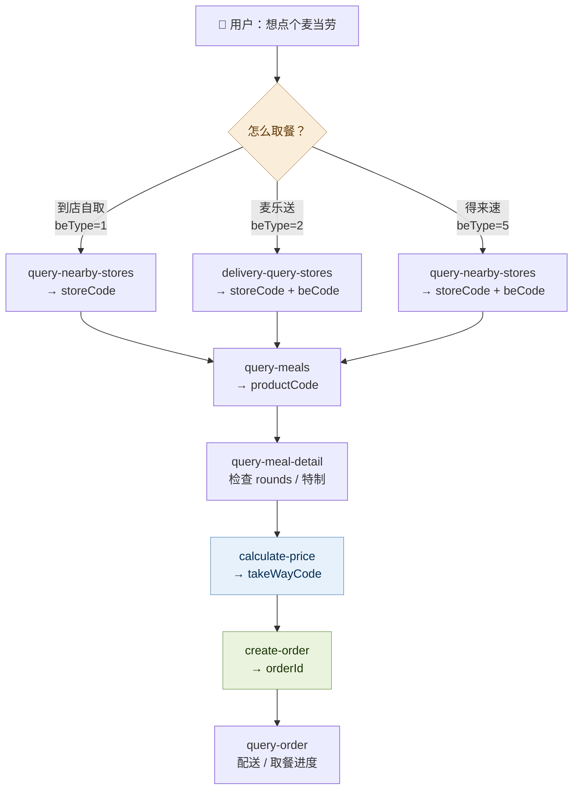
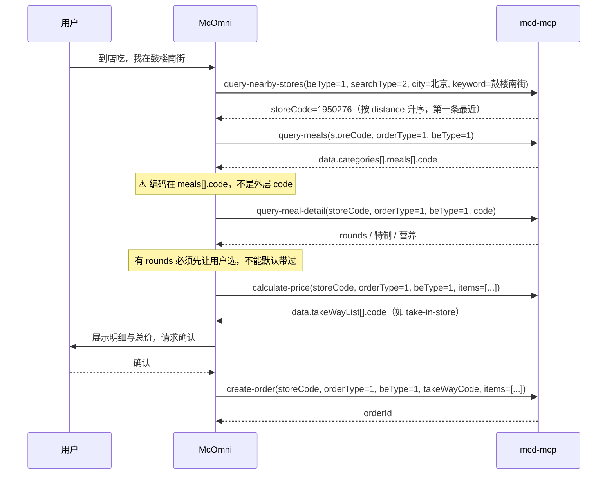
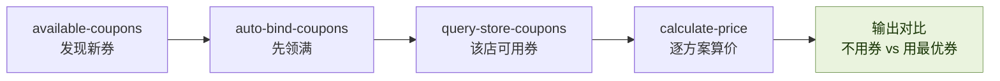
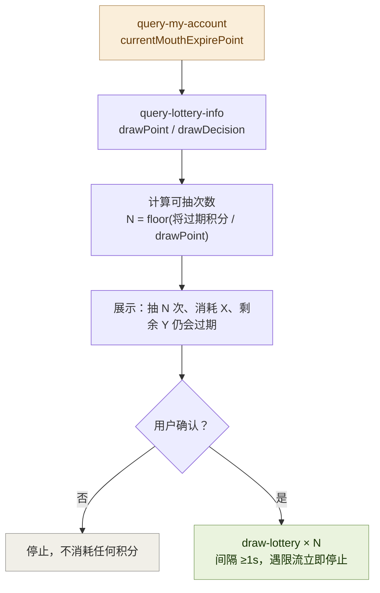

# 🔌 MCP 集成说明 · McOmni

> 本文说明 McOmni **实际使用**的麦当劳 MCP Server、Tool、调用流程与业务价值。
> 文中所有请求 / 响应均为**真实调用**记录（个人信息已脱敏）。

**一句话概括**：35 个工具不是并列关系，而是一条**强依赖链路**——`storeCode` → `beCode` → `productCode` → `takeWayCode` → `orderId`，任何一环猜错，订单就下不出去。

---

## 目录

- [一、接入信息](#一接入信息)
- [二、整体架构](#二整体架构)
- [三、工具清单（35 / 35）](#三工具清单35--35)
- [四、三条关键调用链](#四三条关键调用链)
- [五、真实调用验证记录](#五真实调用验证记录)
- [六、业务价值](#六业务价值)
- [七、可靠性设计](#七可靠性设计)

---

## 一、接入信息

| 项 | 值 |
|---|---|
| Server 名称 | `mcd-mcp` |
| 端点 | `https://mcp.mcd.cn` |
| 传输协议 | Streamable HTTP（**不支持 WebSocket**）|
| 认证方式 | 请求头 `Authorization: Bearer <MCP_TOKEN>` |
| 协议版本 | `2024-11-05` |
| Token 申请 | [open.mcd.cn/mcp](https://open.mcd.cn/mcp)（手机号登录 → 控制台 → 激活）|

握手实测（`initialize`）：

```json
{
  "jsonrpc": "2.0",
  "id": 1,
  "result": {
    "capabilities": { "tools": {} },
    "protocolVersion": "2024-11-05",
    "serverInfo": { "name": "mcd-mcp", "version": "1.0.0" }
  }
}
```

`tools/list` 实测返回 **35 个工具**。

---

## 二、整体架构



> 图中标出的 `beCode` 只在**得来速 / 外送**场景需要；到店自取（`beType=1`）**不传**。
> `takeWayCode` 只能来自 `calculate-price` 的返回，这是下单成功的必要条件。

---

## 三、工具清单（35 / 35）

### 🎫 活动与优惠（4）

| Tool | 用途 |
|---|---|
| `campaign-calendar` | 当月营销活动日历（进行中 / 往期 / 未来），支持 `specifiedDate` 锚点 |
| `available-coupons` | 麦麦省可领取券列表 |
| `auto-bind-coupons` | 一键领取全部可领券（无入参）|
| `query-my-coupons` | 卡包已有券资产 |

### 🏪 到店点餐（7）

| Tool | 用途 |
|---|---|
| `query-nearby-stores` | 到店 / 得来速门店查询（`searchType=1` 收藏、`=2` 按位置）|
| `query-meals` | 门店餐品列表 |
| `query-meal-detail` | 餐品详情（规格 `rounds` / 特制 / 营养）|
| `calculate-price` | 算价（返回 `takeWayList` 供下单使用）|
| `create-order` | 创建订单（到店需 `takeWayCode`）|
| `cancel-order` | 取消订单 |
| `query-order` | 订单详情 / 配送进度 |

### 🛵 麦乐送外送（3）

| Tool | 用途 |
|---|---|
| `delivery-query-addresses` | 配送地址列表 |
| `delivery-create-address` | 新增配送地址 |
| `delivery-query-stores` | 按 `addressId` 查可配送门店 |

### 🎁 积分与商城（7）

| Tool | 用途 |
|---|---|
| `query-my-account` | 积分账户（可用 / 累计 / 本月将过期 / 已过期）|
| `query-lottery-info` | 抽奖活动信息与 `drawDecision` |
| `draw-lottery` | 执行抽奖（服务端原子扣减）|
| `query-my-prizes` | 我的奖品 |
| `mall-points-products` | 积分商城可兑换商品（支持 `catRuleIds` 类目筛选）|
| `mall-product-detail` | 商品详情（取 `skuId`）|
| `mall-create-order` / `mall-order-list` / `mall-order-detail` | 积分兑换下单与订单查询 |

### 🥗 营养数据（2）

| Tool | 用途 |
|---|---|
| `list-nutrition-foods` | 全量餐品营养（能量 / 蛋白质 / 脂肪 / 碳水 / 钠 / 钙）|
| `query-meal-detail` | 单餐品营养 |

### 🎉 派对与活动预约（5）

| Tool | 用途 |
|---|---|
| `query-party-city` | 支持派对的场次城市列表（需 `spuId`）|
| `query-party-store` | 指定城市可举办派对的门店 |
| `query-party-store-date` | 可预约日期 |
| `query-party-store-session` | 场次列表 |
| `party-order-create` | 创建派对订单（仅 `shopId=5`）|

### 🏢 企业团餐（3）

| Tool | 用途 |
|---|---|
| `delivery-query-stores(beType=6)` | 团餐门店 |
| `query-meal-assistance` | 助餐服务（取 `gmServiceCode`）|
| `query-promotions` | 团餐满减 / 满折规则 |

### 🧩 其他（4）

| Tool | 用途 |
|---|---|
| `now-time-info` | 服务器时间（活动 / 预约日期基准）|
| `order-list` | 历史订单 |
| `query-survey-coupon` | 满意度奖券 |
| `query-store-coupons` | 指定门店 + 订单类型下的可用券（比价用）|

---

## 四、三条关键调用链

### ⛓️ 链 A · 到店点餐（含防错）



**关键约束**

| 约束 | 说明 |
|---|---|
| `orderType=1` 下单**必传** `takeWayCode` | 且只能来自 `calculate-price` |
| 到店自取**不传** `beCode` | 得来速 / 外送必须传 |
| `reservationDate` 仅预约场景传 | 非预约不要传 |
| 菜单编码路径 | `data.categories[].meals[].code`，**不是**外层 `code`（外层是状态码 200）|

### ⛓️ 链 B · 领券 + 比价



### ⛓️ 链 C · 积分到期止损（本项目特色）



**实测扣减顺序**：**先扣将过期积分，不足才从其他积分扣**。

```text
「是否溢出」 = 总消耗 > 「本月将过期积分」   （超出 1 分也算溢出）
```

所以脚本默认只花将过期积分；要溢出必须显式加 `--allow-overflow`，否则以退出码 2 拒绝执行——**把决定权留给用户**。

---

## 五、真实调用验证记录

以下 **9 次调用全部为真实请求**，非构造数据（账号数值已在文档中作概括描述，不记录具体数字）。

| # | Tool | 入参 | 返回摘要 | 结论 |
|:--:|---|---|---|---|
| 1 | `initialize` | — | `serverInfo.name=mcd-mcp`, `version=1.0.0` | ✅ 握手成功 |
| 2 | `tools/list` | — | `tools.length = 35` | ✅ 工具面确认 |
| 3 | `now-time-info` | — | 返回 `GMT+08:00` 服务器时间、`dayOfWeek` | ✅ 时间基准可用 |
| 4 | `query-my-account` | — | 返回 `availablePoint` / `accumulativePoint` / `currentMouthExpirePoint` 等 10 个字段 | ✅ 积分止损链路成立 |
| 5 | `campaign-calendar` | — | 当月活动列表（早餐优惠、联名周边、抽奖活动等）| ✅ 活动雷达可用 |
| 6 | `available-coupons` | — | 含「已领取」与「可领取」两种状态，可识别待领券 | ✅ 领券链路可用 |
| 7 | `query-nearby-stores` | `{beType:1, searchType:2, city:"北京", keyword:"昌平"}` | 返回 5 家门店，含 `storeCode`、`distance`、`reservation=true` 及**完整** `reservationTimeOptions`（早餐 / 午餐 / 下午茶 / 夜市 / 宵夜）| ✅ 门店与预约数据可用 |
| 8 | `mall-points-products` | `{catRuleIds:"1>6>20,1>6>21,1>6>22,1>6>34"}` | 返回 19 个派对 / 体验营 / 读书会商品，含 `spuId` 与价格 | ✅ 派对预约链路入口可用 |
| 9 | `list-nutrition-foods` | — | 返回 **160 条**餐品营养记录，字段为 `energyKj / energyKcal / protein / fat / carbohydrate / sodium / calcium` | ✅ 控卡配餐可用 |

**复现方式**

```bash
python scripts/mcd_cli.py call now-time-info
python scripts/mcd_cli.py call query-nearby-stores \
  '{"beType":1,"searchType":2,"city":"北京","keyword":"昌平"}'
```

---

## 六、业务价值

| 面向 | 价值 |
|---|---|
| 🙋 **消费者** | 把「翻活动 → 手动领券 → 挑门店 → 配餐 → 比价 → 下单」的多页面操作压缩成一句话；并把「即将过期的积分」变成可执行的止损方案 |
| 🍔 **麦当劳** | 提升券的领取率与核销率，带动积分消耗与复购；派对 / 体验营等**非餐品业务**获得新的发现入口（原本藏在商城深处）|
| 👩‍💻 **开发者** | 提供一套「强依赖工具链如何可靠编排」的参考实现：`beType` / `orderType` 组合规则、编码传递路径、二次确认边界，均可直接复用 |

---

## 七、可靠性设计

核心是三条原则：

```text
① 绝不臆造编码      一切 code 必须来自上游工具的返回值
② 副作用必二次确认   下单前必算价；抽奖前必展示消耗明细
③ 消耗性取舍交用户   不替用户决定花多少积分、要不要溢出
```

完整 **14 条防错铁律**见 [`SKILL.md`](SKILL.md)，摘要如下：

| # | 规则 |
|:--:|---|
| 1 | `beType` 决定一切（1 自取 / 2 麦乐送 / 5 得来速 / 6 团餐），`orderType` 到店类=1、外送类=2 |
| 2 | `searchType=2` 必须 `city` 与 `keyword` 同时传（只传其一报 `600058`）|
| 3 | 菜单编码取 `data.categories[].meals[].code`，勿取响应外层 `code` |
| 4 | 绝不臆造编码：所有 code 必须来自上游工具返回 |
| 5 | 下单前必须 `calculate-price` 并取得用户确认 |
| 6 | 抽奖两段式：先展示 `drawDecision.nextConsumption`，再执行 |
| 7 | 判定成败看 `success` 字段（结构化返回），`success=false` 即失败，须如实转述 `message` |
| 8 | 消耗性取舍不替用户决定：把每个方案的代价摊开，由用户拍板 |

---

<div align="center">

**本项目为「麦当劳程序员创意开发大赛（M-CODE 1024）」参赛作品，由参赛者独立开发，非麦当劳官方产品。**

</div>
